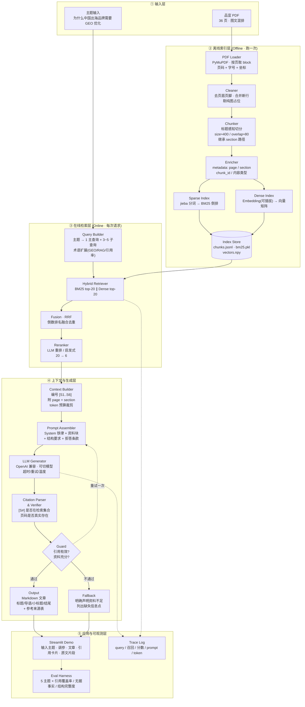
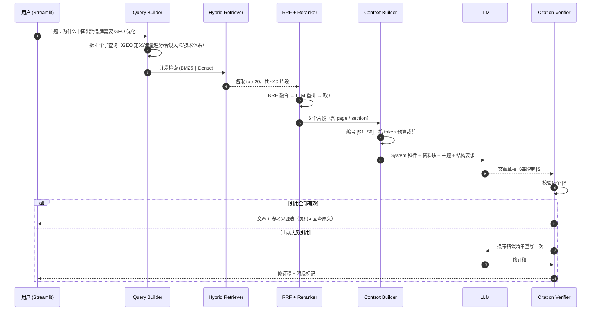
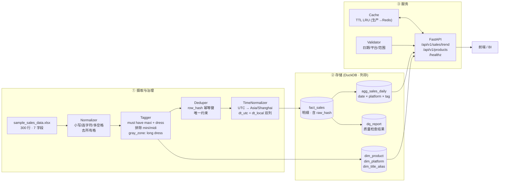

# 万悉科技笔试｜技术栈选用 & 任务二技术架构图

> **前提（待确认）**：正式任务明天上午在**另一台电脑**上开始，本机实测结论已全部清空，先跑第 2 节探测命令再填。
> **选型假设**：无 Docker / 无 Java / 无 Conda、Python + pip 可联网。若实测不符，只调整第 3.1 与第 4 节；架构图（第 5、6 节）不受影响。
> 目标：**2 天内两个项目都能一条命令跑起来**，且每个选型都能在面试时讲出"为什么不选另一个"。

---

## 1. 选型三原则（先定规矩，再选工具）

| 原则 | 含义 | 反面案例 |
|---|---|---|
| **零运维优先** | 不装服务、不起容器、不开端口，全部 pip 装完即用 | Elasticsearch 要 JVM + 单节点 1G 内存；Milvus 依赖 etcd + MinIO |
| **可解释优先** | 核心链路的每一行代码自己写，框架只做可选封装 | 用 LangChain 一把梭，面试问"chunk 怎么切的"就答不上 |
| **可迁移优先** | 本地用轻量实现，但 schema/接口按生产形态设计，能一句话说清怎么换 | 用 SQLite 随便建表，讲不出 ClickHouse 分区键怎么设 |

> 这套原则本身就是**技术判断力**的展示——笔试题"我们重点关注"第 4 条要的就是这个。

---

## 2. 环境探测表（明天在新电脑上填）

> **所有基于旧电脑实测的版本号与"已装/未装"判断已清空**。到新电脑先逐条跑命令，把结果填进"实测值"列，再决定要不要调整选型。

| 项 | 探测命令 | 实测值（待填） | 对选型的影响 |
|---|---|---|---|
| Python | `python --version` / `where python`（或 `which python3`） | 3.13.14（解释器路径因机器而异，用 `where python` 自查；注意排除 `WindowsApps` 占位） | 填入第 3.1 表；若缺失或过低，先装稳定版本，不要静默降级 |
| pip | `python -m pip --version` | pip 26.1.2（随上述 Python） | 能装包即可；同时确认是否需换国内镜像 |
| pip 源 / 联网 | `python -m pip index versions duckdb` | 正常，duckdb 最新 2.0.1 可见（默认源即可，无需镜像） | 超时就换清华 / 阿里镜像，见第 4 节 |
| Node / npm | `node --version` | v22.22.2 | 本方案不用，仅记录 |
| Git | `git --version` | 2.55.0.windows.3 | 用于提交记录（加分项：有 commit 历史） |
| Docker | `docker --version` | 未安装（command not found） | **无论装没装都不启用**；2 天时间不引入 daemon |
| Java / JVM | `java -version` | 未安装（command not found） | 即便已装也**不启用 Elasticsearch**，装中文分词插件不划算 |
| Conda | `conda --version` | 未安装（command not found） | 不用，venv 足够 |
| 编辑器 | `code --version` / 检查现有 IDE | `code` 未在 PATH 中（command not found） | 有则用，没有也能纯终端开发 |
| 操作系统 | `ver`（Windows）/ `uname -a` | Windows 10（10.0.19045） | 决定 venv 激活脚本路径，见第 4 节 |

**填表后的一句话判断**（照抄即可）：这台机器最适合的路线是「**纯 Python 单体 + 单文件数据库 + 云端 LLM API**」，任何需要 daemon 的组件都跳过。若实测发现已装 Docker / Java，也**不用**——2 天时间花在跑通链路和写清取舍上，比多引一个中间件值。

> 结论边界：第 3 节往后的选型与架构图是基于上述假设的**默认方案**，不依赖具体版本号；填表只影响 3.1 的版本栏和第 4 节的安装命令。

---

## 3. 技术栈总表

### 3.1 通用

| 用途 | 选型 | 版本 | 为什么 | 备选（何时换） |
|---|---|---|---|---|
| 语言 | Python | **3.13.14**（第 2 节实测） | JD 第一要求；版本按第 2 节实测填写 | 若个别库无对应 wheel，退回上一个稳定版本 **3.12.x** |
| 环境 | venv + pip | **pip 26.1.2（随 Python 3.13.14）** | 随 Python 自带，零安装 | uv（想更快可装；非必需） |
| 配置 | python-dotenv | 1.x | 密钥不进代码 | — |
| 日志 | loguru | 0.7 | 一行接入，结构化 | stdlib logging |
| 测试 | pytest | 8.x | 面试看重"工程习惯" | — |

### 3.2 任务一：数据工程

| 用途 | 选型 | 为什么选它 | 为什么不用别的 |
|---|---|---|---|
| **存储/计算** | **DuckDB 1.x** | pip 装完即用、单文件、列存、支持窗口函数/`EXPLAIN ANALYZE`/Parquet 分区；SQL 方言与 ClickHouse/PG 高度可迁移 | ES：要 JVM + 1G 内存 + 中文分词插件，装完半天没了；ClickHouse：Windows 需独立安装包+服务，且 300 行数据用不上；MySQL：行存，做"按日聚合趋势"是逆着存储模型走 |
| 数据处理 | pandas + openpyxl | 读 xlsx 一行代码；300 行数据内存处理足够 | Polars（更快但没必要）；纯 stdlib（我验证过可行，但代码更长不好读） |
| API | FastAPI + uvicorn | 自带 Swagger（面试官直接点开就能试）、pydantic 自动校验、异步 | Flask（无自动文档）；Django（太重） |
| 参数校验 | pydantic v2 | 日期范围/枚举校验一行声明 | 手写 if（易漏） |
| 缓存 | cachetools（TTL LRU，进程内） | 零依赖、零运维，能证明"缓存设计"这件事 | Redis：要装服务；**但要在文档里写清"生产换 Redis，key 设计不变"** |
| 并发压测（可选） | locust 或 简单 asyncio 脚本 | 出一个 QPS/P95 数字 | wrk（Windows 上编译麻烦） |
| 数据质量 | 自写 `dq_checks.py` | 5 条规则（唯一性/完整性/口径/异常/及时性），比引框架更能讲 | Great Expectations（配置成本高，收益不明显） |

**关键说明（面试可直接说）**：本地方案是 DuckDB，但 **schema 与查询是按生产形态设计的**——事实表 + 日预聚合表 + 排序键/分区键，迁移到 ClickHouse 只改 DDL，迁移到 PostgreSQL 加 `pg_partman` 按周分区即可。这句话比"我用了 ClickHouse"更有分量。

### 3.3 任务二：RAG 工程

| 用途 | 选型 | 为什么选它 | 为什么不用别的 |
|---|---|---|---|
| **PDF 解析** | **PyMuPDF (fitz)** | 快（36 页 <1s）、能拿每个 block 的坐标+字号（**用字号判断标题层级**，这招很加分）、能导图片 | pdfplumber：表格好但慢 5–10 倍；`unstructured`：依赖一堆模型，装完 2G |
| 清洗 | 自写正则 + 规则 | 页眉页脚/断行/纯图占位都是可知的固定模式 | LLM 清洗（贵且慢，36 页不值得） |
| **Chunk** | 自写标题感知切分 | 保留 `page`/`section`/`parent_heading`，**引用溯源的前提**；参数（size/overlap）可调可讲 | LangChain `RecursiveCharacterTextSplitter`：黑盒，且默认不保页码 |
| **稀疏检索** | **BM25（自写或 rank_bm25）+ jieba 分词** | 中文必须分词；BM25 对"GEO""合规""央媒"这类**专有名词/术语**召回极稳；零模型零下载 | 纯向量：专有名词和数字容易飘；ES：要 JVM |
| **稠密检索** | 可插拔：① API embedding ② 本地 bge-small-zh ③ 关闭 | 默认走 ①，没 key 就自动关，链路不至于跑不起来 | 只做向量：一条路走到黑，没 key 直接交付失败 |
| 融合 | RRF（倒数排名融合） | 无需调权重、两路分数不可比也能融 | 加权求和（要先归一化，还说不清权重哪来的） |
| Rerank | ① LLM 重排（20→6）② 启发式（标题命中/长度/位置） | 无 cross-encoder 模型也能做重排，且 LLM 重排便宜（一次调用） | bge-reranker：需 torch 2.5G，为 36 页文档不值 |
| LLM | DeepSeek-V3 / Qwen-Plus（OpenAI 兼容接口） | 便宜、中文强、`openai` SDK 一个 `base_url` 就能切 | 本地跑 7B：无 GPU 时慢到无法迭代 |
| SDK | `openai` (兼容模式) | 换厂商只改 `base_url` + `model` | 各厂商 SDK 各写一套 |
| **Demo** | **Streamlit** | 一条命令起页面，天然适合"左侧输入/右侧文章+引用卡片"；还能做参数滑杆展示 chunk 策略 | Gradio：布局不如 Streamlit 适合长文；FastAPI+HTML：要写前端，时间不够 |
| 评测 | 自写 eval 脚本 + 5 个主题 | 指标自己定义（引用覆盖率/无据事实数/结构完整度），能解释 | RAGAS：依赖重、指标黑盒 |

> **这套选型的核心叙点**：题目说"技术栈不限"，但真正被打分的是**"检索、上下文构建、引用溯源、幻觉控制，而非只调用一次模型 API"**。所以我把力气全压在 `chunk 带页码 → 生成带编号 → 生成后回查编号` 这条链上，向量库用什么都行。

---

## 4. 环境安装清单（预计 6–8 分钟，约 400MB，以实测网络为准）

> 执行顺序：**先跑第 2 节探测命令并填表 → 再执行下面安装**。新电脑上若 `python` 不可用，改用 `python3`（把下面所有 `python` 替换掉）。

```bash
# 0) 先把三份原始材料拷到 trendee-assessment/data_raw/
#    万悉科技AI数据工程师笔试题.pdf · 样例销售数据.xlsx · Trendee品宣-公开版.pdf

# 1) 建环境
cd trendee-assessment
python -m venv .venv

# 激活（按系统选一条）
.venv\Scripts\activate          # Windows CMD / Git Bash
# .venv\Scripts\Activate.ps1    # Windows PowerShell
# source .venv/bin/activate     # macOS / Linux

# 2) 装依赖（分两批，避免一次超时）
pip install duckdb pandas openpyxl fastapi "uvicorn[standard]" pydantic python-dotenv loguru cachetools pytest
pip install pymupdf jieba rank-bm25 numpy openai streamlit

# 2') pip 源超时就加镜像重试（同一串包名）
# pip install -i https://pypi.tuna.tsinghua.edu.cn/simple <上面同一串包名>
# pip install -i https://mirrors.aliyun.com/pypi/simple   <上面同一串包名>

# 3) 落一份 requirements.txt
pip freeze > requirements.txt
```

| 包 | 体积（约） | 作用 |
|---|---|---|
| duckdb | 25MB | 列存库 |
| pandas | 12MB | 读 xlsx / 数据整理 |
| fastapi + uvicorn + pydantic | 20MB | API |
| pymupdf | 20MB | PDF 解析 |
| jieba | 20MB | 中文分词 |
| rank-bm25 | 0.1MB | 稀疏检索 |
| openai | 1MB | LLM 调用 |
| streamlit | 30MB | Demo |
| 其余 | <5MB | — |

> **不装**：torch / sentence-transformers（2.5G，只在需要本地向量时才装）、faiss（无本地向量就不需要）、langchain（不需要）、elasticsearch（不需要）、docker（不需要）。

**模型/Key 准备**（二选一，10 分钟）：
- DeepSeek：`https://api.deepseek.com` + `deepseek-chat`（最便宜，中文好）
- 阿里百炼：`https://dashscope.aliyuncs.com/compatible-mode/v1` + `qwen-plus`（顺手可拿 `text-embedding-v3` 做向量）

---

## 5. 任务二技术架构图

> 独立可编辑版本：`assets/task2-rag-architecture.svg`（矢量，可直接贴进 README / PPT / 飞书文档，缩放不糊）

### 5.1 分层架构（Mermaid）



### 5.2 时序（一次生成请求）



### 5.3 关键设计点（面试必讲）

| 环节 | 设计 | 为什么不这样做 | 面试怎么答 |
|---|---|---|---|
| **Chunk** | 按标题层级切，单块 ≈400 字、overlap 80，保留 `page` + `section_path` | 不按固定 512 字符硬切 | "硬切会把'对比表'和它的表头切开，检索到半张表比检索不到更糟" |
| **Chunk 粒度取舍** | 偏小（400）利于精准命中，靠 overlap + section 路径补上下文 | 不用 1000+ 大块 | "大块召回准但塞满上下文，且引用页码会指到一大段，溯源变弱" |
| **检索** | BM25 + 向量双路，RRF 融合 | 不用单一向量 | "品牌名、'LLM 原生 GEO'、'65%+ 引用率'这类词，BM25 比向量稳" |
| **Rerank** | 先融合再重排，20→6 | 不直接把 40 个片段塞给模型 | "上下文越长，中间片段越容易被忽略（lost in the middle）" |
| **上下文组织** | 编号 + 页码 + 章节名，按主题相关度排序，控制预算 | 不只拼文本 | "编号是引用溯源的锚点，没有编号就无法校验" |
| **引用校验** | 生成后解析 `[S#]`，逐个比对本次检索集合 | 不靠"提示模型别乱引" | "Prompt 是软约束，校验是硬约束，两者要叠" |
| **幻觉控制** | ① 资料不足先判 ② Prompt 铁律 ③ 引用白名单 ④ 数值白名单（PDF 里没有的数字不许出现） | 不靠降低 temperature | "temperature=0 只是让它更稳定地编，不是不编" |
| **资料不足** | 输出"本文仅依据品宣 PDF，关于 X 未提供信息"，并列出缺什么 | 不硬编 | 对应题目"资料不足时应明确处理，而非直接猜测" |

---

## 6. 任务一技术架构图（配套，简版）



**Task 1 里三个最容易丢分的点**（已在架构里体现）：
1. 归一化不是"转小写"，是**三段式判定 + 负样本 + 灰区**（第 3 节数据摸底有证据）；
2. 时区不是"加 8 小时"，是**60 条夜间记录会跨天**，必须声明口径；
3. 去重不是 `DELETE`，是**幂等键 + 保留可审计**（否则"销量为什么少了 12 条"答不上来）。

---

## 7. 生产化对照表（体现"可扩展"这一分）

| 本地（2 天 demo） | 生产形态 | 迁移成本 |
|---|---|---|
| DuckDB 单文件 | ClickHouse（排序键 `(platform, dt, tag)` + 按月分区）或 PG + `pg_partman` | 改 DDL + 换驱动 |
| 进程内 TTL 缓存 | Redis（key: `trend:{tag}:{start}:{end}:{platforms}`） | 换实现，key 设计不变 |
| 全量重算预聚合 | Airflow/DolphinScheduler 日调度 + 增量 upsert | 加 DAG |
| 单机 uvicorn | Gunicorn/Uvicorn workers + Nginx + 限流 | 加部署配置 |
| `chunks.jsonl` + `vectors.npy` | pgvector / Milvus / Qdrant | 换存储，接口不变 |
| 无鉴权 | API Key + 租户隔离 | 加中间件 |
| 日志打屏 | 结构化日志 + 指标（QPS/P95/缓存命中/召回率） | 接 Prometheus |

> 面试时说"我知道 demo 和生产差在哪，差在这 7 项，我列了迁移路径"——比假装做完生产级更可信。

---

## 8. 降级预案（保证一定能交）

| 如果…… | 就…… | 损失 |
|---|---|---|
| 没有 LLM API Key | 用"检索结果 + 模板"生成占位文章，链路照跑；文档里写明 | 文章质量，但链路完整度分不丢 |
| 不想下 2.5G 的 torch | 关掉向量检索，纯 BM25 + 查询扩展 | 语义召回，但引用溯源不受影响 |
| Streamlit 起不来 | 改 CLI：`python -m rag.run "主题"` 输出 md | UI 分，但核心分不丢 |
| 新电脑 Python 缺失 / 版本过低 / `python` 命令不通 | 先装稳定版本或统一改用 `python3`；**不要静默降级**，装完重跑第 2 节探测表 | 半小时 |
| 个别库无对应 Python 版本的 wheel | 退回上一个稳定 Python 版本重建 venv（具体版本号按第 2 节实测填写） | 半小时 |
| pip 源超时 / 装不上 | 换国内镜像 + 分两批装（见第 4 节）；仍失败就先装必做子集：`duckdb pandas openpyxl fastapi uvicorn pydantic pymupdf jieba numpy openai` | 半小时 |
| 时间只剩 1 天或半天 | 保 Task 1 完整 + Task 2 链路，文档写透取舍；按任务清单 4.7 的必做/可砍表执行 | 深度，但覆盖面不丢 |

---

## 9. 时间与产出的对应关系（2 天版）

| 投入 | 产出 | 得分点 | 2 天版 |
|---|---|---|---|
| 0.75h | 环境探测 + 依赖安装 + 项目骨架 | 工程习惯 | 必做 |
| 4h | Task 1 管道 + 归一化 + 幂等去重 + 时区 | 数据质量（重点） | 必做 |
| 2.5h | Task 1 预聚合 + 4 条 SQL + FastAPI + 错误处理 | 查询/API（重点） | 必做 |
| 1h | Task 1 性能推演（只推演不压测）+ 质量报告 + README | 大数据量（重点） | 必做，压测可砍 |
| 3h | Task 2 解析 + 带页码 chunk + BM25 + 混合检索 | 检索（重点） | 必做，向量索引可关 |
| 2.5h | Task 2 上下文编号 + 完整 Prompt + 生成 + 引用校验 + 拒答 | 溯源/幻觉（重点） | 必做 |
| 1h | Streamlit Demo（或 CLI）+ 1 个失败案例 | 可运行（加分） | **可砍** |
| 2h | 两份 README + 设计取舍 + 示例输出 + 打包发邮件 | 落地（重点） | 必做 |

> 必做合计约 **15.75h**，2 天按每天 8.5h 留约 1.25h 缓冲；砍掉可砍项后余量更宽。与 `岗位分析&笔试题逐字稿&任务清单.md` 第 4.1 / 4.7 / 第 5 节的口径一致。

---

## 10. 明日环境安装 Agent 提示词（换机后第一条消息直接发）

> 下面整段可复制。它是自包含的：不依赖这份文档里的任何本机实测数字，AI agent 会自己探测并回填。
> 若两份 md 没能带到新电脑，把提示词里"两份方案文档"相关句子删掉即可，依赖清单和验证步骤仍然完整。

```text
你是环境部署助手。请在当前这台电脑上，为「万悉科技 AI 数据工程师笔试」搭好开发环境并验证通过。
今天只做环境与骨架，不要写任何业务代码。

【背景】
- 我只有 2 天完成笔试，正式任务从今天上午开始，第一件事就是装环境。
- 两个子项目：task1_data_api（销售数据 → DuckDB + FastAPI）、task2_rag（品宣 PDF → RAG 写作系统）。
- 项目根目录：优先使用当前目录下的 trendee-assessment/；若不存在，先问我确认路径再创建。
- 三份原始材料（先找到并复制到 <项目根>/data_raw/）：
  万悉科技AI数据工程师笔试题.pdf、样例销售数据.xlsx、Trendee品宣-公开版.pdf
- 同目录可能有两份方案文档（只读参考）：
  岗位分析&笔试题逐字稿&任务清单.md、技术栈选用&技术架构图.md
  若存在，按其中「第 2 节环境探测表」「第 4 节安装清单」「第 8 节降级预案」「附：目录建议」执行。

【第一步：探测并回填】
依次运行并记录真实输出（命令不存在就记「未安装」，不要报错中断）：
  python --version          （不可用则试 python3 --version）
  python -m pip --version
  python -m pip index versions duckdb    （探测 pip 源是否可用）
  node --version ; git --version ; docker --version ; java -version ; conda --version ; code --version
  ver（Windows）或 uname -a（macOS / Linux）
若两份 md 在，把结果填进 技术栈选用&技术架构图.md 第 2 节「环境探测表」的「实测值（待填）」列，
并把 Python / venv 版本填进第 3.1 表对应「（待填）」处。
除此之外不要改动这两份 md 的任何内容，尤其不要改笔试题逐字稿和架构图。

【第二步：建环境 + 装依赖】
  cd <项目根>
  python -m venv .venv        （若 python 不可用，全文改用 python3）
  激活，按系统选一条：
    Windows CMD / Git Bash:  .venv\Scripts\activate
    Windows PowerShell:      .venv\Scripts\Activate.ps1
    macOS / Linux:           source .venv/bin/activate
分两批安装，避免一次超时：
  pip install duckdb pandas openpyxl fastapi "uvicorn[standard]" pydantic python-dotenv loguru cachetools pytest
  pip install pymupdf jieba rank-bm25 numpy openai streamlit
若 pip 源超时，加 -i https://pypi.tuna.tsinghua.edu.cn/simple 重试同一批包名
（备选镜像 https://mirrors.aliyun.com/pypi/simple）。不要擅自换包、换版本或跳过依赖。
装完执行：pip freeze > requirements.txt

【严格不要装】
torch、sentence-transformers、faiss、langchain、elasticsearch、docker、conda，
以及任何需要常驻 daemon 的服务。理由：2 天时间 + demo 规模，这些只会拖慢进度。
若你认为必须装，先停下来问我，不要自作主张。

【第三步：验证（逐条跑，贴出真实输出，不许假装成功）】
  python -c "import duckdb, pandas, openpyxl, fastapi, uvicorn, pydantic, dotenv, loguru, cachetools, pytest, fitz, jieba, rank_bm25, numpy, openai, streamlit; print('all imports ok')"
四个冒烟测试：
  1) duckdb 建内存表，跑一条带 GROUP BY 的聚合查询并打印结果
  2) fitz 打开 Trendee品宣-公开版.pdf，打印页数（应为 36），并确认能取到某一页的文本
  3) jieba 对「为什么中国出海品牌需要进行GEO优化」分词并打印结果
  4) uvicorn --version 与 streamlit --version 能正常输出
任何一条失败：按方案文档第 8 节降级预案处理（换源、分批、退回稳定 Python 版本），
并如实告诉我，不要跳过或隐瞒。

【第四步：建骨架（只建目录和空文件，不写业务逻辑）】
按方案文档末尾「附：目录建议」创建 trendee-assessment/ 的目录树；
创建 .gitignore（排除 .venv/、.env、*.duckdb、__pycache__/、大文件）；
创建 .env.example，只放键名、值留空：LLM_BASE_URL / LLM_API_KEY / LLM_MODEL / DB_PATH；
创建顶层 README.md，只写「快速开始」占位，不写实现。
若 git 可用：git init 并做一次初始提交（chore: bootstrap assessment env）。

【第五步：输出报告】
用简短表格告诉我：
  1) 环境探测表各项实测值
  2) 实际装上的关键包版本
  3) 5 条验证（import + 4 个冒烟）的通过 / 失败
  4) 与选型假设不一致的地方、你做了什么处理
  5) 我接下来可以直接开始写哪一步

【约束】
- 不写业务代码、不改架构图、不改笔试题逐字稿。
- 遇到 Python 缺失 / 版本过低 / 权限不足 / 网络不通：先告诉我并给出 2 个选项，
  不要静默降级，也不要擅自安装系统级软件。
- 全程用中文回复。
```

---

## 附：目录建议

```
trendee-assessment/
├── README.md                     # 总览 + 快速开始 + 架构图
├── .env.example
├── requirements.txt
├── task1_data_api/
│   ├── README.md
│   ├── data/                     # xlsx 拷贝 + duckdb 文件
│   ├── sql/                      # 01_schema / 02_tag / 03_agg / queries
│   ├── src/                      # normalize / ingest / timeutil / api / cache / dq_checks
│   ├── tests/
│   └── docs/                     # design.md / perf.md
└── task2_rag/
    ├── README.md
    ├── data/                     # pdf / pages.jsonl / chunks.jsonl / index/
    ├── prompts/                  # system.md / article.md
    ├── src/                      # parse / clean / chunk / index / retrieve / rerank /
    │                             # context / generate / cite_check / guard
    ├── app.py                    # Streamlit
    ├── eval/
    └── docs/                     # rag-design.md / eval.md
```
