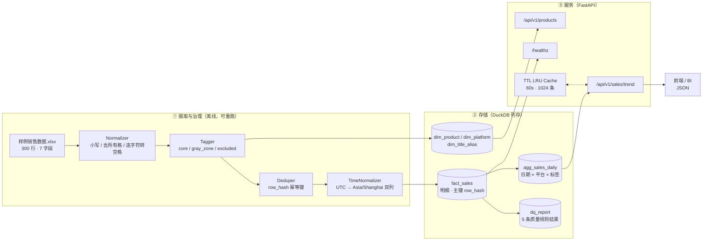

# Task 1 设计说明：销售数据查询与 API

> 逐条对照笔试题要求见 [`checklist.md`](./checklist.md)。

## 0. 架构总览



数据流一句话：**xlsx → 归一化/打标/去重/时区 → DuckDB 四张表 → FastAPI 只读预聚合表 → JSON**。


## 1. 存储选型

**DuckDB 单文件**。理由：pip 装完即用、列存、原生窗口函数与物化视图语义、SQL 方言与 ClickHouse/PostgreSQL 高度可迁移。
不选 Elasticsearch（JVM + 中文分词插件成本 > 收益，300 行数据用不上）；不选 MySQL（行存做"按日聚合"是逆着存储模型走）。

**生产迁移路径**（一句话可讲）：schema 不变，迁移 ClickHouse 时给 `fact_sales` 加 `ORDER BY (platform, dt_local) PARTITION BY toYYYYMM(dt_local)`；迁移 PostgreSQL 用 `pg_partman` 按周分区。预聚合表 → 物化视图 + 日调度增量刷新。

## 2. Schema

见 `sql/01_schema.sql`。核心结构：

```
dim_platform / dim_product / dim_title_alias   ← 维表
fact_sales        一行 = 一次销售记录，主键 row_hash（幂等键）
agg_sales_daily   日期 × 平台 × tag_status 的日预聚合，查询主力
dq_report         数据质量检查结果，可审计
```

设计要点：
- **dt_utc / dt_local 双列**：原始口径与业务口径都保留，聚合只用 `dt_local`。
- **agg_sales_daily 先于 API 存在**：在线查询不扫明细表；明细表只为补榜/审计。
- **ingest_batch**：每批摄取可追溯、可回滚。

**索引结构**：
- `fact_sales.row_hash` 主键 → DuckDB 建 ART 索引，去重 anti-join 为 O(1) 探测；`dim_product.product_id` 同理支撑 JOIN。
- `agg_sales_daily` 复合主键 `(dt_local, platform, tag_status)` 天然构成「日期前缀」有序扫描路径——趋势查询的 `BETWEEN start AND end` 是范围扫，而不是全表扫。
- 生产形态（ClickHouse）：`ORDER BY (platform, dt_local)` 让「平台 + 日期区间」同时命中稀疏索引；PG 则对 `(platform, dt_local)` 建 B-tree + `pg_partman` 周分区。

## 3. "maxi dress" 归一化与识别规则（三段式）

原始 `category` 只有 dress/pants/skirt 等粗粒度，**不能**直接当 maxi dress 用。识别基于 `title`：

1. **归一化**：小写 → 所有格撇号转空格（`women's` → `women s`）→ 连字符/下划线转空格 → 压缩连续空白。例：`Women's Maxi-Dress Floral` → `women s maxi dress floral`。
2. **core**：归一化后词集同时含 `maxi` 与 `dress`，且不含 `mini`/`midi`（词级匹配，不用子串——`dress` 不会误匹配 `address`）。
3. **excluded**：含 `mini`/`midi`（长度档位冲突）；或含 `maxi` 但无 `dress`——**"Maxi Skirt" 不是 maxi dress**（实测 11 条，product 2027）。
4. **gray_zone**：含 `dress` + `long` 但无 `maxi`（实测 `Elegant Long Dress`，1 商品 11 条）——计入但打 `is_gray_zone` 标记，API 通过 `include_gray_zone` 参数显式开关，默认不计入。

实现：`src/normalize.py`（Python 版为准）+ `sql/02_tag.sql`（SQL 版交叉验证），两版规则一致。

## 4. 重复数据处理（幂等去重）

- **row_hash = md5(7 个业务字段固定顺序拼接)** 作为 `fact_sales` 主键。
- 摄取前 anti-join 库中已有 hash；摄取后统计：输入 300 → 文件内重复 12 → 落库 288。
- **重跑验证**：第二次摄取 inserted=0，fact_total 仍 288（`duplicate_filtered=300` 表示全部命中已有）。
- 审计：被滤掉的重复计数写进 `dq_report`，可回答"销量为什么少了 12 条"——**不是 DELETE，是摄取幂等 + 留痕**。

## 5. 时区口径（关键声明）

- 源 `timestamp` **声明为 UTC**（附件无时区标注，此假设写入 README 与 API meta）。
- `dt_local = UTC + 8h`（Asia/Shanghai，无夏令时），业务聚合一律用 `dt_local`。
- **实测影响**：300 条中 **132 条** UTC ≥ 16:00，转本地后跨到次日——按日聚合的归属会整体后移。例如 `2024-01-01 16:33 UTC` 的 10 件销量计入本地 `01-02`。若不声明口径，趋势图会整体右移一天。

## 6. API 设计

| 路由 | 参数 | 返回 | 错误 |
|---|---|---|---|
| `GET /api/v1/sales/trend` | `start_date`/`end_date`（必填，含）、`platforms`（逗号分隔，空=全平台）、`include_gray_zone`（默认 false） | `{meta, count, data:[{date, total_sales, records, by_platform}]}` | 400 日期倒序/超 366 天/未知平台；422 缺参数；503 库不存在 |
| `GET /api/v1/products` | `tag`（core/gray_zone/excluded） | 商品维表 | 400 非法 tag |
| `GET /healthz` | — | 存活 + fact 行数 | 503 |

示例：

```bash
GET /api/v1/sales/trend?start_date=2024-01-01&end_date=2024-01-07&platforms=website,app

{
  "meta": {"timezone": "Asia/Shanghai", "include_gray_zone": false, "cached": false, ...},
  "count": 6,
  "data": [
    {"date": "2024-01-01", "total_sales": 4,  "records": 1, "by_platform": {"website": 4}},
    {"date": "2024-01-02", "total_sales": 25, "records": 2, "by_platform": {"app": 10, "website": 15}},
    ...
  ]
}
```

错误处理原则：参数问题 4xx 带具体 detail（不是 500 裸异常）；空结果 200 + `count=0`（不是 404——空是合法业务状态）；DB 未初始化 503 带修复提示。

## 7. 数据质量说明（dq_checks 5 条规则）

| 规则 | 校验内容 | 实测结果 |
|---|---|---|
| uniqueness_row_hash | fact 主键无重复 | ✅ 288=288 |
| completeness_not_null | 核心字段无空值 | ✅ 0 空 |
| tag_glossary_consistency | 聚合表 tag 只允许 core/gray_zone | ✅ |
| anomaly_sales_range | sales_count ∈ (0, 10000] | ✅ 0 异常 |
| timeliness_coverage | 时间跨度闭合（2024-01-01 → 2024-03-13） | ✅ |

结果落 `dq_report` 表（含 checked_at、ingest_batch），每次摄取自动重跑。
